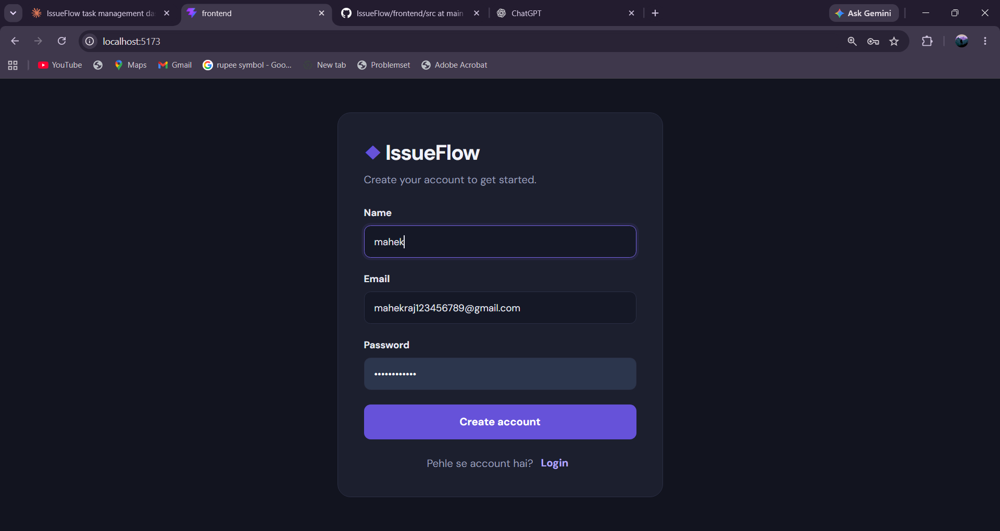
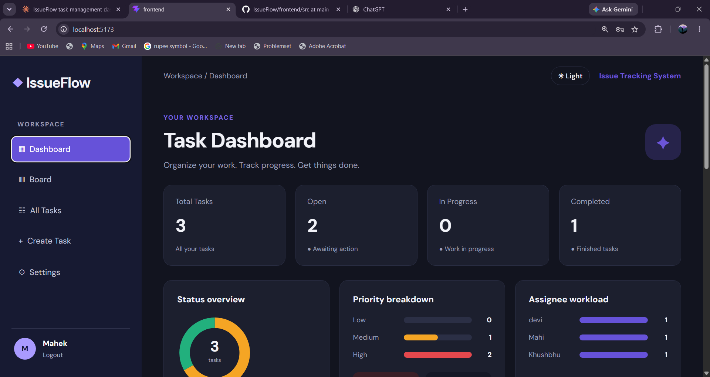
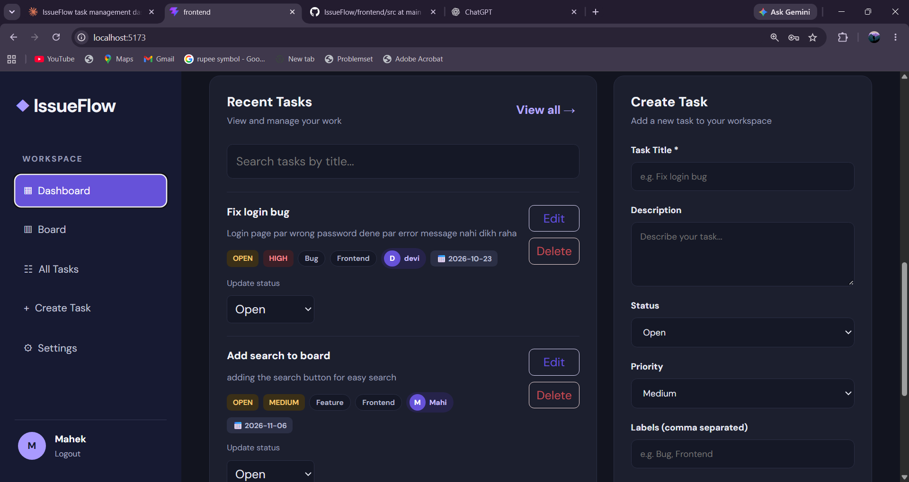
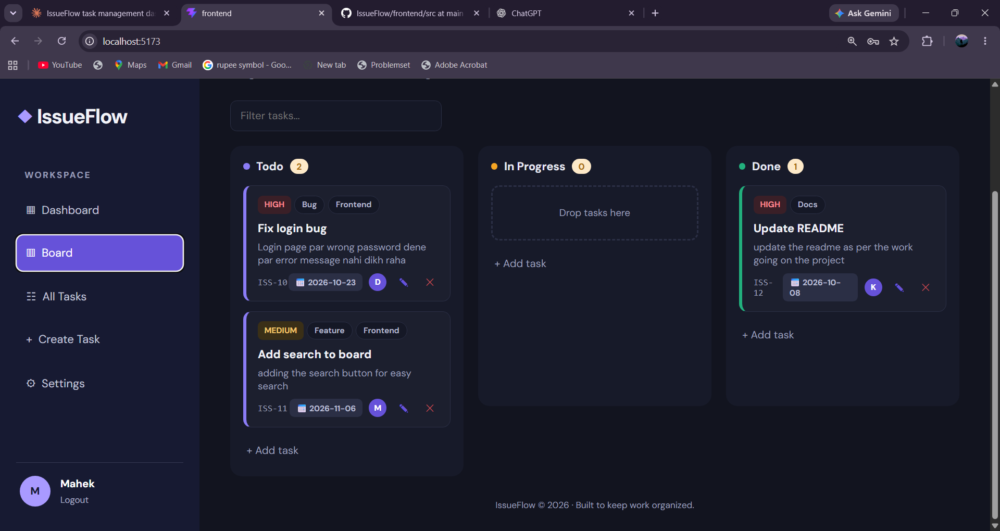
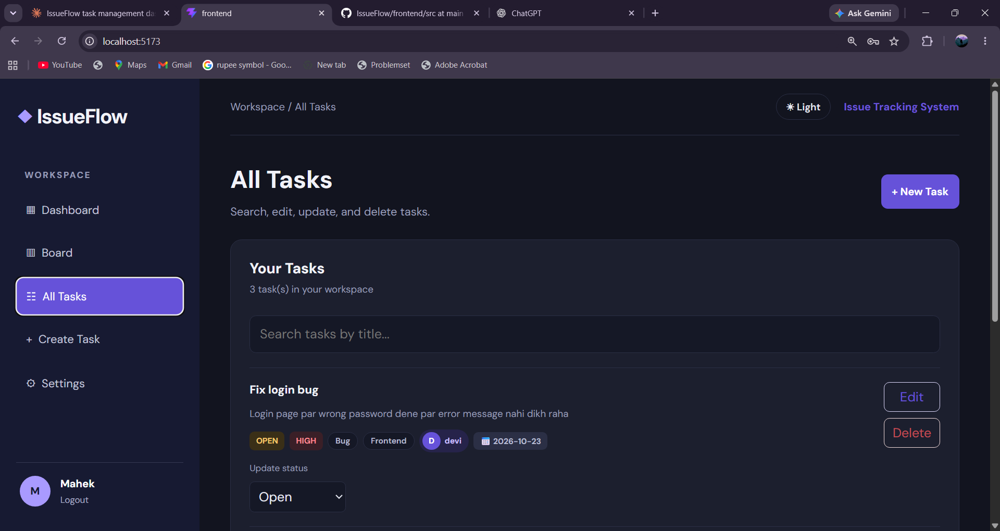
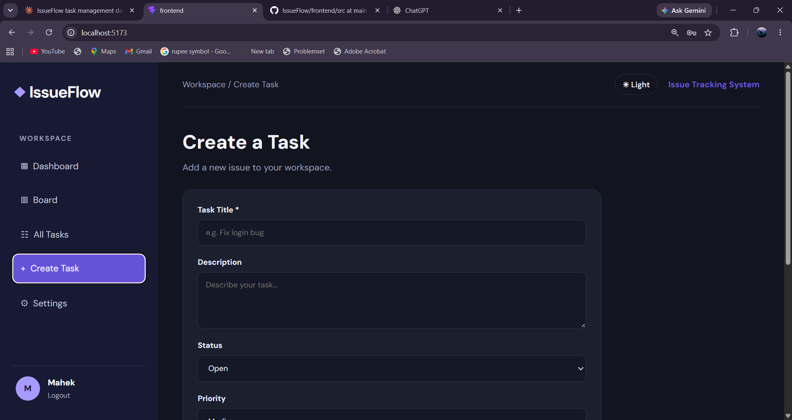

# IssueFlow

A full-stack task management app with user login, a drag and drop Kanban board, dashboard charts and a dark mode.

## Live demo

- **App:** https://issue-flow-ashen.vercel.app
- **API:** https://issueflow-9z85.onrender.com

> The backend runs on a free instance, so the first request after a period of inactivity can take 30-60 seconds to respond.

## Tech stack
- **Frontend:** React (Vite)
- **Backend:** Spring Boot, Spring Data JPA
- **Database:** PostgreSQL
- **Hosting:** Vercel (frontend), Render (backend), Neon (PostgreSQL)

## Features
- Register and login (BCrypt password hashing, token based)
- Every user sees only their own tasks
- Create, edit and delete tasks
- Status, priority, labels, assignee and due date (overdue tasks highlighted)
- Drag and drop Kanban board
- Dashboard with status, priority and assignee workload charts
- Search, filters and sorting
- Dark mode (saved between visits)
- Toast notifications and a custom delete confirmation

## Screenshots

### Login


### Dashboard




### Kanban board


### All tasks with filters


### Create task


## Run locally

### 1. Database
Create a PostgreSQL database:
```sql
CREATE DATABASE issueflow_db;
```

### 2. Backend (port 8080)
```powershell
cd IssueFlow
$env:DB_PASSWORD='your_postgres_password'
.\mvnw spring-boot:run
```
Tables are created automatically on the first run.

### 3. Frontend (port 5173)
```powershell
cd IssueFlow\frontend
npm install
npm run dev
```

Open http://localhost:5173, register an account and start adding tasks.

## Environment variables

| Variable | Used by | Description |
|---|---|---|
| `DB_URL` | Backend | JDBC URL (defaults to local PostgreSQL) |
| `DB_USERNAME` | Backend | Database user (defaults to `postgres`) |
| `DB_PASSWORD` | Backend | Database password |
| `CORS_ORIGINS` | Backend | Allowed frontend origins |
| `VITE_API_URL` | Frontend | Backend API base URL |

## Project structure
```
IssueFlow
├── src/main/java/com/issueflow   Spring Boot backend
├── frontend/src                  React frontend
├── screenshots                   README images
└── Dockerfile                    Backend container (Render)
```

## API overview
| Method | Endpoint | Description |
|---|---|---|
| POST | /api/auth/register | Create an account |
| POST | /api/auth/login | Login and get a token |
| GET | /api/tasks | List your tasks |
| POST | /api/tasks | Create a task |
| PUT | /api/tasks/{id} | Update a task |
| DELETE | /api/tasks/{id} | Delete a task |

## Notes
- The database password is read from environment variables and is never stored in the repository.
- Authentication is a simple token scheme meant for learning. For production use Spring Security with JWT and HTTPS.

## Author
Mahek